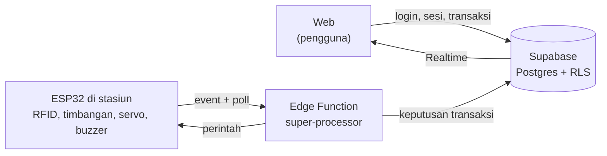

# Smart-Loopbox / Stasiun Wadah Pintar

Stasiun peminjaman dan pengembalian wadah makan pakai ulang untuk mahasiswa dan staf Universitas Trisakti. Pengguna login dengan akun kampus, scan QR di stasiun, lalu memilih pinjam atau kembalikan. Stasiun membaca tag RFID dan berat wadah, server memutuskan hasilnya, dan pintu terbuka atau tertutup otomatis.

Proyek PKM-KC. Status: **prototipe yang sudah berjalan** (web, backend, dan perangkat keras terhubung).

**Demo web:** https://dmradihdyo.github.io/Stasiun_Wadah_Pintar/

## Cara kerja

Prinsipnya: **sensor hanya melapor, server yang memutuskan.** ESP32 tidak memegang kunci database. Ia hanya memakai token perangkat, dan semua perubahan data transaksi dilakukan fungsi database yang bersifat atomik.

### Alur pengguna
1. Login Google dengan akun `@trisakti.ac.id`, lalu scan QR stasiun atau ketik kodenya. Server membuka sesi (satu stasiun hanya bisa punya satu sesi aktif).
2. Pilih **Pinjam** atau **Kembalikan**. Server mencatat transaksi berstatus menunggu.
3. ESP32 menanyakan perintah ke server secara berkala (10 detik saat idle, 3 detik saat ada sesi), sekaligus menandai dirinya hidup.

### Pinjam
1. Stasiun membaca tag RFID dan menimbang wadah di dalam stasiun.
2. Server memeriksa tag terdaftar, wadah tersedia, kuota belum penuh, dan berat dalam rentang.
3. Jika lolos, pintu terbuka dan stasiun menunggu timbangan kosong. Pinjaman baru dicatat setelah wadah terbukti diambil, lalu pintu menutup.
4. Wadah tidak diambil dalam 30 detik: pintu menutup dan peminjaman dibatalkan tanpa pinjaman.

### Kembalikan
1. Pintu terbuka saat transaksi menunggu. Pengguna meletakkan wadah di tatakan.
2. Server memeriksa wadah itu memang pinjaman pengguna dan beratnya dalam rentang.
3. Diterima: pintu menutup. Ditolak (berat atau tag salah): pintu **tetap terbuka**.
4. Batal atau gagal: pintu menutup hanya bila timbangan kosong dan tidak ada tag di dekat pembaca. Jika masih ada wadah, buzzer mengingatkan dan web menampilkan banner.

Buzzer: dua bunyi pendek = diterima, satu panjang = ditolak, tiga pendek = masih ada wadah di stasiun.

## Aturan sistem

| Aturan | Nilai bawaan |
|---|---|
| Kuota pinjam | 2 wadah per pengguna |
| Berat wadah valid | 80-150 g (pinjam dan kembalikan) |
| Ambang timbangan kosong | 8 g |
| Masa sesi web | 60 detik, diperpanjang tiap 15 detik selama web terbuka |
| Stasiun dianggap hidup | terlihat dalam 90 detik terakhir |
| Batas waktu mengambil wadah (pinjam) | 30 detik |
| Akun yang boleh masuk | domain `@trisakti.ac.id` (dibatasi di web dan database) |

Rentang berat, kuota, dan ambang dapat disesuaikan di firmware dan fungsi database.

## Teknologi

| Bagian | Teknologi |
|---|---|
| Web | HTML, CSS, JavaScript tanpa proses build; supabase-js, jsQR, qrcodejs dari CDN; GitHub Pages |
| Backend | Supabase: Auth (Google OAuth), PostgreSQL, Row Level Security, Realtime, `pg_cron` |
| API perangkat | Supabase Edge Function `super-processor` (TypeScript / Deno) |
| Firmware | Arduino C++ untuk ESP32; library MFRC522, HX711, ESP32Servo |

### Perangkat keras

| Komponen | Pin ESP32 |
|---|---|
| RFID RC522 | SS 5, RST 22, SCK 18, MOSI 23, MISO 19 |
| Load cell dengan HX711 | DOUT 4, SCK 16 |
| Servo pintu (continuous) | 21 |
| Buzzer aktif | 27 |

### Data

Tabel utama: `profiles`, `containers`, `stations`, `station_sessions`, `transactions`, `loans`, `device_events`. Perubahan transaksi, pinjaman, dan status wadah dilakukan dalam satu transaksi database oleh fungsi `security definer`; browser hanya boleh membaca data miliknya sendiri lewat RLS.

## Keamanan

- Kunci rahasia Supabase tidak ada di web maupun firmware. Web hanya memuat *publishable key* yang memang aman dipublikasikan karena akses dibatasi RLS.
- ESP32 diautentikasi dengan token perangkat terpisah (header `x-device-token`), yang disimpan sebagai secret Edge Function dan di berkas `secrets.h` lokal (tidak di-commit).
- Event sensor tidak otomatis menjadi transaksi sah. Server memeriksa sesi aktif, pemilik pinjaman, status wadah, kuota, dan berat.
- Transaksi memakai kunci idempotensi, sehingga permintaan ulang tidak tercatat dua kali.

## Status pengujian

Diuji pada prototipe stasiun SLB-001:

- Event ESP32 sampai ke Edge Function dan tersimpan di database dengan identitas stasiun.
- Status hidup/mati stasiun mengikuti waktu terakhir perangkat terlihat; Wi-Fi putus tersambung ulang sendiri.
- Sesi stasiun: satu pengguna per stasiun, sesi kedaluwarsa, stasiun mati ditolak.
- Pinjam dan kembalikan diputuskan server; berat di luar rentang, wadah bukan milik pengguna, dan wadah tidak tersedia ditolak.
- Buzzer, servo, dan alur pintu mengikuti transaksi, termasuk pintu yang tetap terbuka saat pengembalian ditolak.

## Batasan yang diketahui

- Servo continuous tidak punya sensor posisi pintu, sehingga posisi pintu hanya perkiraan.
- Satu permintaan HTTPS dari ESP32 memakan sekitar 2 detik, jadi respons pintu bisa terlambat beberapa detik.
- Firmware belum memvalidasi sertifikat TLS (`setInsecure`). Perlu diganti sebelum dipakai di luar prototipe.
- Tabel pinjaman belum punya tanggal jatuh tempo, jadi fitur terlambat dan pengingat email belum ada.
- Panel admin (`js/admin.js`) masih untuk rancangan skema awal dan belum sesuai database yang dipakai sekarang.

## Isi repositori ini

| Jalur | Keterangan |
|---|---|
| `index.html`, `css/`, `js/app.js`, `js/supabase.js`, `js/config.js`, `assets/` | Aplikasi web yang dipakai |
| `js/admin.js` | Panel admin dari rancangan awal, belum disesuaikan |
| `supabase/`, `docs/`, `tools/` | Rancangan backend awal (`device-api`, migrasi, simulator ESP32). **Tidak dipakai** oleh sistem final |

Firmware ESP32, skrip SQL backend, dan Edge Function `super-processor` yang dipakai sistem final berada di folder proyek lokal dan belum disertakan di repositori ini.

## Menjalankan web

Web bersifat statis dan tidak perlu build.

1. Isi `js/config.js` dengan URL proyek Supabase dan *publishable key*.
2. Atur Google OAuth di Supabase (Authentication, Providers) dan tambahkan alamat web ke *Redirect URLs*.
3. Jalankan server statis, misalnya `python -m http.server 8080`, atau unggah ke GitHub Pages. Login Google dan kamera membutuhkan HTTPS (atau `localhost`).

QR stasiun berisi alamat web dengan kode stasiun, contoh: `https://dmradihdyo.github.io/Stasiun_Wadah_Pintar/?station=SLB-001`.
