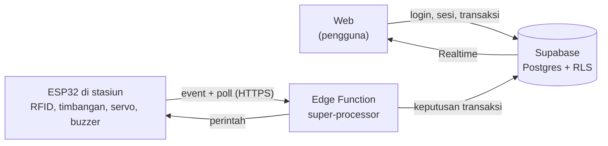

# ARKID: Stasiun Wadah Pintar (Smart-Loopbox)

**ARKID: Automasi Return Kemasan berbasis Identifikasi Digital.** Stasiun peminjaman dan pengembalian wadah makan pakai ulang untuk mahasiswa dan staf Universitas Trisakti. Pengguna login dengan akun kampus, scan QR di stasiun, lalu memilih pinjam atau kembalikan. Stasiun membaca tag RFID dan berat wadah, server memutuskan hasilnya, dan pintu terbuka atau tertutup otomatis.

Proyek PKM-KC. Status: **prototipe yang sudah berjalan** (web, backend, dan perangkat keras terhubung).

**Demo web:** https://dmradihdyo.github.io/ARCID-3D-SIMULASI/

## Daftar isi

- [Cara kerja](#cara-kerja)
- [Aturan sistem](#aturan-sistem)
- [Teknologi](#teknologi)
- [Firmware ESP32 (`ST.ino`)](#firmware-esp32-stino)
- [Keamanan](#keamanan)
- [Status pengujian](#status-pengujian)
- [Batasan yang diketahui](#batasan-yang-diketahui)
- [Isi repositori](#isi-repositori)
- [Menjalankan web](#menjalankan-web)
- [Memasang firmware](#memasang-firmware)

## Cara kerja



Prinsipnya: **sensor hanya melapor, server yang memutuskan.** ESP32 tidak memegang kunci database. Ia hanya memakai token perangkat, dan semua perubahan data transaksi dilakukan fungsi database yang bersifat atomik.

### Alur pengguna

1. Login Google dengan akun `@trisakti.ac.id`, lalu scan QR stasiun atau ketik kodenya. Server membuka sesi (satu stasiun hanya bisa punya satu sesi aktif).
2. Pilih **Pinjam** atau **Kembalikan**. Server mencatat transaksi berstatus menunggu.
3. ESP32 menanyakan perintah ke server secara berkala (`poll`, sekaligus penanda bahwa stasiun hidup): tiap 2 detik saat idle, tiap 0,7 detik saat ada sesi web aktif atau pintu terbuka.

### Pinjam

1. Stasiun membaca tag RFID dan menimbang wadah di dalam stasiun (pintu masih tertutup).
2. Server memeriksa tag terdaftar, wadah tersedia, kuota belum penuh, dan berat dalam rentang.
3. Jika lolos, pintu terbuka dan stasiun menunggu timbangan kosong. Pinjaman baru dicatat setelah wadah terbukti diambil, lalu pintu menutup.
4. Wadah tidak diambil dalam 30 detik: pintu menutup dan peminjaman dibatalkan tanpa pinjaman.

### Kembalikan

1. Pintu terbuka saat transaksi menunggu. Pengguna meletakkan wadah di tatakan.
2. Server memeriksa wadah itu memang pinjaman pengguna dan beratnya dalam rentang.
3. Diterima: pintu menutup. Ditolak (berat atau tag salah): pintu **tetap terbuka**.
4. Batal atau gagal: pintu menutup hanya bila timbangan kosong dan tidak ada tag di dekat pembaca. Jika masih ada wadah, buzzer mengingatkan dan web menampilkan banner.

### Buzzer

| Bunyi | Arti |
|---|---|
| Satu bunyi sedang (200 ms) | Peminjaman lolos validasi, menunggu wadah diambil |
| Dua bunyi pendek | Transaksi diterima |
| Satu bunyi panjang | Ditolak |
| Tiga bunyi pendek | Masih ada wadah atau tag di stasiun (diulang tiap 10 detik) |

## Aturan sistem

| Aturan | Nilai bawaan |
|---|---|
| Kuota pinjam | 2 wadah per pengguna |
| Rentang berat yang ditandai valid oleh firmware | 60-200 g (keputusan akhir ada di server) |
| Ambang timbangan kosong | 5 g |
| Masa sesi web | 60 detik, diperpanjang tiap 15 detik selama web terbuka |
| Stasiun dianggap hidup | terlihat dalam 90 detik terakhir |
| Batas waktu mengambil wadah (pinjam) | 30 detik |
| Akun yang boleh masuk | domain `@trisakti.ac.id` (dibatasi di web dan database) |

Wadah prototipe: plastik (84 g) dan stainless (146 g), masing-masing dengan tag RFID bernomor seri unik. Rentang berat, kuota, dan ambang dapat disesuaikan di firmware dan fungsi database.

## Teknologi

| Bagian | Teknologi |
|---|---|
| Web | HTML, CSS, JavaScript tanpa proses build; supabase-js, jsQR, qrcodejs dari CDN; GitHub Pages |
| Backend | Supabase: Auth (Google OAuth), PostgreSQL, Row Level Security, Realtime, `pg_cron` |
| API perangkat | Supabase Edge Function `super-processor` (TypeScript / Deno) |
| Komunikasi perangkat | HTTPS (REST, JSON) dengan polling. Tidak memakai MQTT |
| Firmware | Arduino C++ untuk ESP32; library MFRC522, HX711, ESP32Servo |

### Perangkat keras

| Komponen | Pin ESP32 |
|---|---|
| RFID RC522 | SS 5, RST 22, SCK 18, MOSI 23, MISO 19 |
| Load cell dengan HX711 | DOUT 4, SCK 16 |
| Servo pintu (continuous) | 21 |
| Buzzer aktif | 27 |

### Data

Tabel utama: `profiles`, `containers`, `stations`, `station_sessions`, `transactions`, `loans`, `device_events`. Perubahan transaksi, pinjaman, dan status wadah dilakukan dalam satu transaksi database oleh fungsi `security definer`; browser hanya boleh membaca data miliknya sendiri lewat RLS.

## Firmware ESP32 (`ST.ino`)

Firmware membaca sensor, menggerakkan pintu, dan melapor ke server. Keputusan diterima atau ditolak selalu datang dari server.

### Event yang dikirim ke server

Semua event dikirim lewat `POST` JSON ke Edge Function dengan header `x-device-token` dan `station_id`.

| Event | Kapan dikirim |
|---|---|
| `device_online` | Sekali, setelah Wi-Fi tersambung saat boot |
| `poll` | Berkala; respons memuat perintah transaksi dan status sesi |
| `weight_read` | Tag diizinkan terbaca dan berat stabil: berisi UID, berat, dan hasil validasi awal |
| `container_removed` | Pinjam: timbangan kosong stabil, wadah terbukti diambil |
| `removal_timeout` | Pinjam: wadah tidak diambil dalam 30 detik |
| `door_blocked` / `door_cleared` | Pengembalian gagal dan masih ada wadah atau tag / kondisi itu sudah bersih |
| `station_stage` | Tahapan proses, supaya indikator di web mengikuti keadaan nyata stasiun |

Tahapan `station_stage`: `request_received`, `reading`, `door_open`, `removed_detected`, `door_closing`, `unknown_tag`. Tiap tahap dikirim sekali per transaksi. Fitur ini dapat dimatikan dengan `ENABLE_STAGE_EVENTS = false`.

### Perilaku penting

- **Koneksi HTTPS dipakai ulang** (keep-alive) supaya jabat tangan TLS tidak diulang di setiap event. Jika koneksi lama ditutup server, pengiriman dicoba ulang satu kali.
- **Daftar UID di firmware** (`ALLOWED_UIDS`): hanya tag di daftar ini yang diteruskan ke server. Tag lain diabaikan, atau dilaporkan sebagai `unknown_tag` bila ada transaksi menunggu.
- **Berat stabil**: 4 sampel (rata-rata 2 pembacaan tiap sampel). Bila selisih antar sampel lebih dari 4 g, berat dianggap belum stabil dan tidak ada event yang dikirim.
- **Tare saat boot**: timbangan di-tare saat menyala (15 pembacaan), jadi **tatakan harus kosong saat stasiun dinyalakan**. Faktor kalibrasi tetap `425.66`.
- **Pemulihan sensor**: bila HX711 tidak terdeteksi saat boot, firmware mencoba lagi dan melakukan tare ulang begitu sensor siap.
- **Wi-Fi putus**: dicoba tersambung ulang tiap 10 detik.

### Waktu penting (nilai bawaan)

| Parameter | Nilai |
|---|---|
| Poll saat idle | 2 detik |
| Poll saat sesi aktif atau pintu terbuka | 0,7 detik |
| Baca tag di dalam stasiun saat ada transaksi | tiap 0,3 detik |
| Pinjam: pemeriksaan timbangan saat menunggu wadah diambil | tiap 0,2 detik |
| Pinjam: kosong stabil dianggap wadah diambil | 0,7 detik |
| Kembalikan gagal: kosong dan tanpa tag sebelum pintu menutup | 1 detik |
| Jeda bunyi sebelum pintu menutup | 0,8 detik |
| Putaran servo buka dan tutup | 300 ms (maksimum keras 2000 ms) |

### Perintah Serial Monitor (115200 baud)

Untuk menguji dan menyetel servo tanpa transaksi:

| Perintah | Fungsi |
|---|---|
| `OPEN` / `CLOSE` | Putar servo ke arah buka / tutup selama `OPENTIME` / `CLOSETIME` |
| `STOP` | Hentikan servo |
| `OPENTIME <ms>` / `CLOSETIME <ms>` | Ubah lama putaran, 50-2000 ms. Hilang saat stasiun di-reset |
| `HELP` | Tampilkan daftar perintah |

Berat di tatakan juga ditampilkan tiap detik sebagai `[MONITOR BERAT]` saat stasiun idle. Pembacaan rutin ini tidak dikirim ke server.

## Keamanan

- Kunci rahasia Supabase tidak ada di web maupun firmware. Web hanya memuat *publishable key* yang memang aman dipublikasikan karena akses dibatasi RLS.
- ESP32 diautentikasi dengan token perangkat terpisah (header `x-device-token`), yang disimpan sebagai secret Edge Function dan di berkas `secrets.h` lokal (tidak di-commit).
- Event sensor tidak otomatis menjadi transaksi sah. Server memeriksa sesi aktif, pemilik pinjaman, status wadah, kuota, dan berat.
- Transaksi memakai kunci idempotensi, sehingga permintaan ulang tidak tercatat dua kali.

## Status pengujian

Diuji pada prototipe stasiun SLB-001:

- Event ESP32 sampai ke Edge Function dan tersimpan di database dengan identitas stasiun.
- Status hidup/mati stasiun mengikuti waktu terakhir perangkat terlihat; Wi-Fi putus tersambung ulang sendiri.
- Sesi stasiun: satu pengguna per stasiun, sesi kedaluwarsa, stasiun mati ditolak.
- Pinjam dan kembalikan diputuskan server; berat di luar rentang, wadah bukan milik pengguna, dan wadah tidak tersedia ditolak.
- Buzzer, servo, dan alur pintu mengikuti transaksi, termasuk pintu yang tetap terbuka saat pengembalian ditolak.

## Batasan yang diketahui

- Servo continuous tidak punya sensor posisi pintu, sehingga posisi pintu hanya perkiraan dan bergantung pada lama putaran.
- Respons pintu mengikuti interval polling (0,7-2 detik) ditambah waktu satu permintaan HTTPS, jadi masih ada jeda pendek antara perintah di web dan gerak pintu.
- Firmware belum memvalidasi sertifikat TLS (`setInsecure`). Perlu diganti sebelum dipakai di luar prototipe.
- Daftar tag yang diizinkan tertanam di firmware (dua tag prototipe). Menambah wadah baru berarti mengubah `ALLOWED_UIDS` dan memasang ulang firmware.
- Rentang berat belum seragam di semua bagian: firmware 60-200 g, nilai bawaan tampilan web 80-120 g. Selaraskan dengan aturan di server dan berat kedua jenis wadah.
- Tabel pinjaman belum punya tanggal jatuh tempo, jadi fitur terlambat dan pengingat email belum ada.
- Panel admin (`js/admin.js`) masih untuk rancangan skema awal dan belum sesuai database yang dipakai sekarang.

## Isi repositori

| Jalur | Keterangan |
|---|---|
| `ST.ino` | **Firmware ESP32 final** yang dipakai stasiun |
| `index.html`, `css/`, `js/app.js`, `js/supabase.js`, `js/config.js`, `assets/` | Aplikasi web yang dipakai |
| `js/admin.js` | Panel admin dari rancangan awal, belum disesuaikan |
| `supabase/`, `docs/`, `tools/` | Rancangan backend awal (`device-api`, `send-reminders`, migrasi, simulator ESP32). **Tidak dipakai** oleh sistem final |

Skrip SQL backend dan Edge Function `super-processor` yang dipakai sistem final berada di folder proyek lokal dan belum disertakan di repositori ini. `docs/protokol-esp32.md` menjelaskan protokol rancangan awal (`device-api`), bukan protokol firmware `ST.ino`.

## Menjalankan web

Web bersifat statis dan tidak perlu build.

1. Isi `js/config.js` dengan URL proyek Supabase dan *publishable key*.
2. Atur Google OAuth di Supabase (Authentication, Providers) dan tambahkan alamat web ke *Redirect URLs*.
3. Jalankan server statis, misalnya `python -m http.server 8080`, atau unggah ke GitHub Pages. Login Google dan kamera membutuhkan HTTPS (atau `localhost`).

QR stasiun berisi alamat web dengan kode stasiun, contoh: `https://dmradihdyo.github.io/Stasiun_Wadah_Pintar/?station=SLB-001`.

## Memasang firmware

1. Pasang Arduino IDE dengan dukungan board ESP32, lalu pasang library **MFRC522**, **HX711**, dan **ESP32Servo** lewat Library Manager.
2. Arduino IDE mewajibkan nama folder sketch sama dengan nama file. Taruh `ST.ino` di folder bernama `ST`.
3. Buat berkas `secrets.h` di folder yang sama. Berkas ini berisi rahasia dan **jangan di-commit**:

   ```cpp
   const char* WIFI_SSID     = "nama-wifi";
   const char* WIFI_PASSWORD = "kata-sandi-wifi";
   const char* DEVICE_TOKEN  = "token-perangkat";   // sama dengan secret di Edge Function
   ```

4. Cek `SUPABASE_URL` dan `STATION_ID` di bagian konfigurasi `ST.ino`. Ganti bila memakai proyek Supabase atau stasiun lain.
5. Kosongkan tatakan timbangan, pilih board ESP32 dan port, lalu unggah. Buka Serial Monitor pada 115200 baud untuk melihat log.
